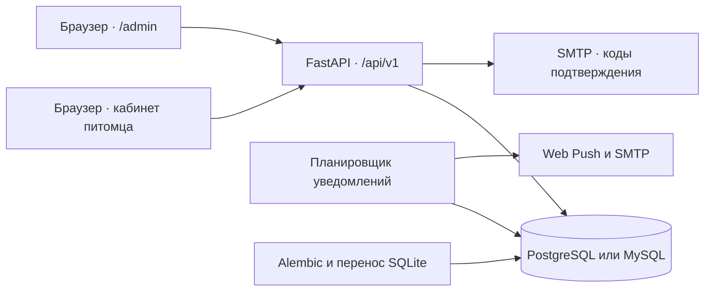

# Архитектура PetCare

PetCare — веб-приложение для ухода за питомцами. Один сервер раздаёт React-интерфейс и обслуживает API `/api/v1`. Клиент обращается к API на том же домене.

## Интерфейс и сервер

- `app/frontend/main.tsx` выбирает пользовательский интерфейс или отдельный экран `/admin`. Пользовательский кабинет пока сочетает React и переходный модуль `legacy/runtime.js`. Панель управления реализована в React/TypeScript и загружается отдельно.
- `app/main.py` запускает FastAPI, проверяет версию схемы и обслуживает маршруты питомцев, здоровья, питания, ухода, документов и знакомств.
- `app/features.py` обрабатывает регистрацию, вход, совместный доступ, пользовательские настройки и часть защищённых операций.
- `app/auth.py` проверяет пароль через bcrypt и выдаёт JWT, привязанный к записи входа. Отключение аккаунта, смена роли и завершение всех входов немедленно делают старые токены недействительными.
- `app/admin.py` проверяет права на каждом административном маршруте. В панели доступны роли, тарифы, блокировки, история входов, контакт поддержки и журнал изменений. Маршрут `/api/v1/admin/status` объединяет счётчики из базы и системный снимок из `app/server_metrics.py`. Браузер запрашивает его каждые 10 секунд в открытой вкладке и хранит последние 10 минут замеров в памяти вкладки.
- `app/notifications.py` запускается планировщиком. Он проверяет события и отправляет уведомления с учётом настроек пользователя.

## Регистрация и вход

Самостоятельная регистрация создаёт заявку `EmailChallenge` и отправляет шестизначный код по SMTP. Аккаунт появляется только после подтверждения кода. Код действует 10 минут, допускает до пяти попыток и используется один раз. В базе хранится подпись кода. Если SMTP недоступен, регистрация через сайт останавливается. Создание через панель доступно администратору и оставляет почту аккаунта неподтверждённой.

`app/login_guard.py` хранит счётчики в базе. Пятый неверный пароль подряд блокирует вход в аккаунт на 30 секунд, независимо от IP. Успешный вход или окончание паузы сбрасывает серию аккаунта. На пятидесятой проверенной ошибке IP блокируется для входа до снятия в панели. IP-счётчик общий для всех аккаунтов и успешным входом не сбрасывается. Запросы, остановленные уже действующей блокировкой, не проверяют пароль и не увеличивают счётчик. Блокировка IP распространяется на вход с паролем и начало или подтверждение входа по коду. Дополнительно действует ограничение в 60 проверок пароля в час с одного IP. Если контакт поддержки заполнен, он показывается рядом с сообщением о блокировке.

IP берётся из адреса клиента, который сервер передаёт приложению в ASGI. Само приложение не доверяет заголовкам вроде `X-Forwarded-For`. При запуске за прокси нужно проверить, что сервер передаёт реальный адрес клиента, а слои проксирования доверяют только своим прокси. Если все запросы приходят как один IP, блокировка коснётся всех входов с этого адреса. Данные об устройстве берутся из User-Agent, то есть это описание браузера, а не идентификатор устройства. Записи, созданные до добавления поля IP, показываются без адреса.

## Данные и выпуск

- `app/models.py` описывает таблицы SQLAlchemy. Основные связи идут от пользователя к его питомцам, а от питомца — к событиям, медицинским записям, документам и участникам совместного ухода.
- Пользователи, роли, сеансы, блокировки и настройки поддержки хранятся отдельно. Журнал содержит административные действия. Ответы API с IP и устройствами доступны только администраторам, а браузер их не кэширует.
- Production использует PostgreSQL или MySQL; SQLite служит для локальной разработки, тестов и переноса старой базы. Обновление схемы запускается отдельно от веб-приложения через Alembic. Свежая сборка интерфейса создаётся командой `npm run build`.
- Инструкции размещения и переноса данных: [MySQL на REG.RU](MYSQL_HOSTING.md), [PostgreSQL](POSTGRESQL.md). На сервере перед обновлением сделайте проверяемую резервную копию, примените миграцию и проверьте вход, подтверждение почты, панель и совместный уход.
